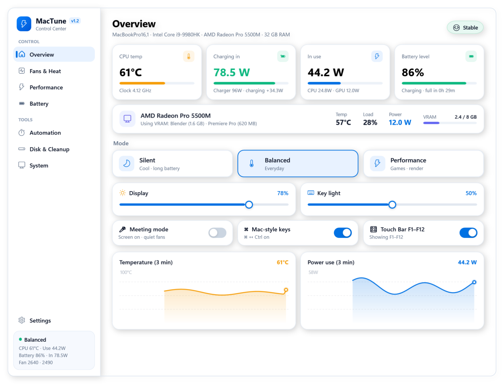
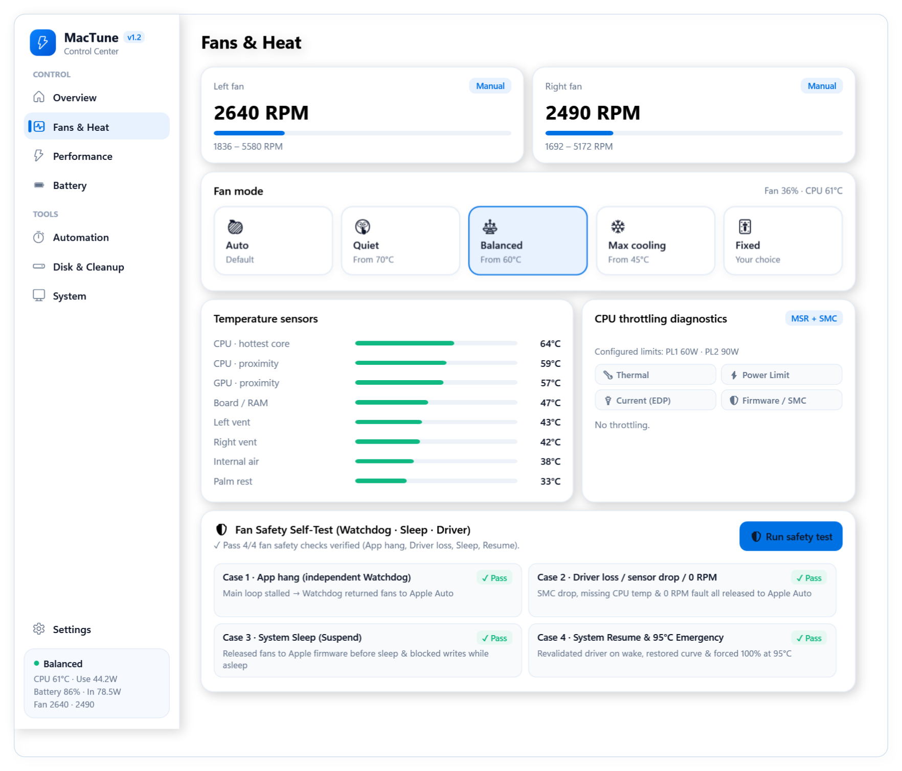
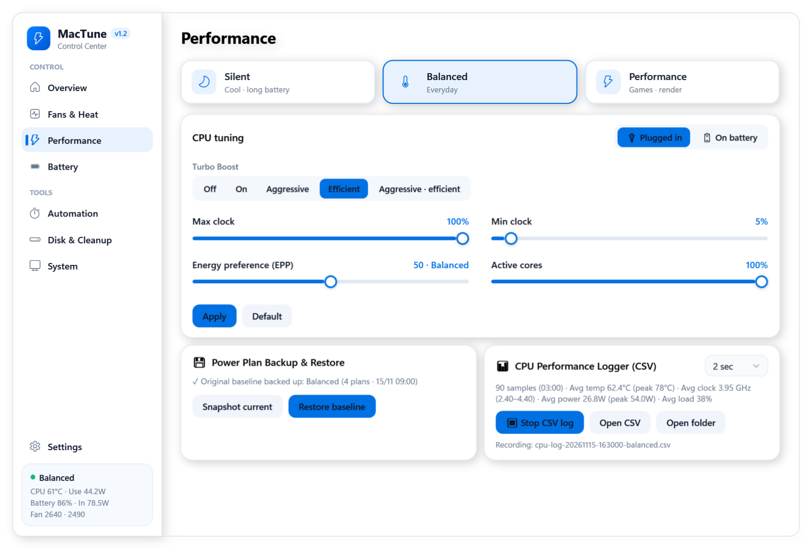
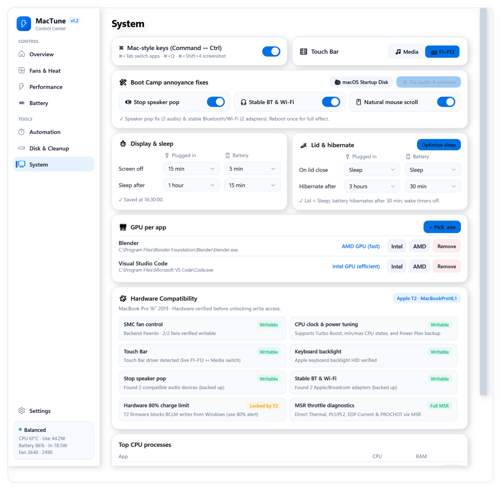
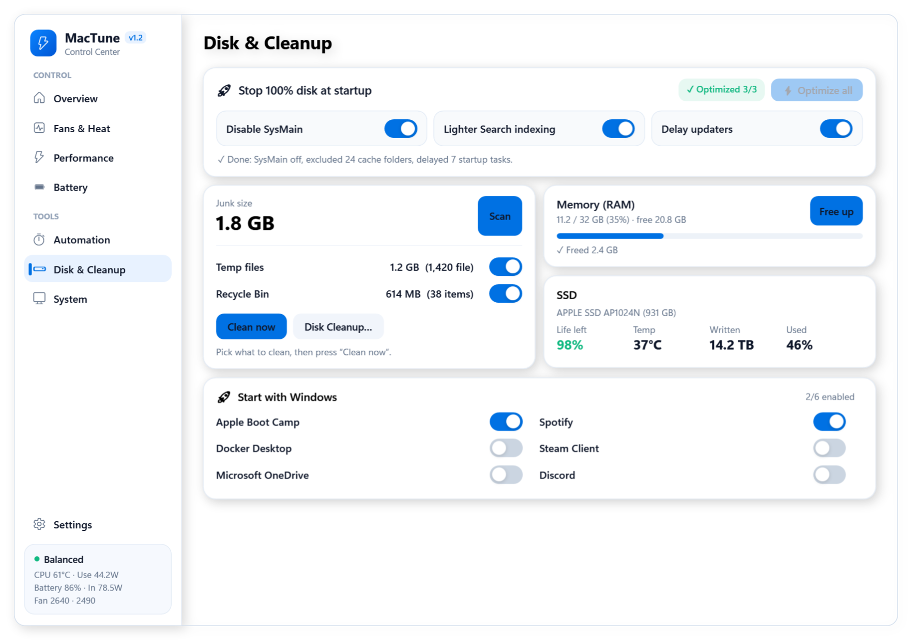
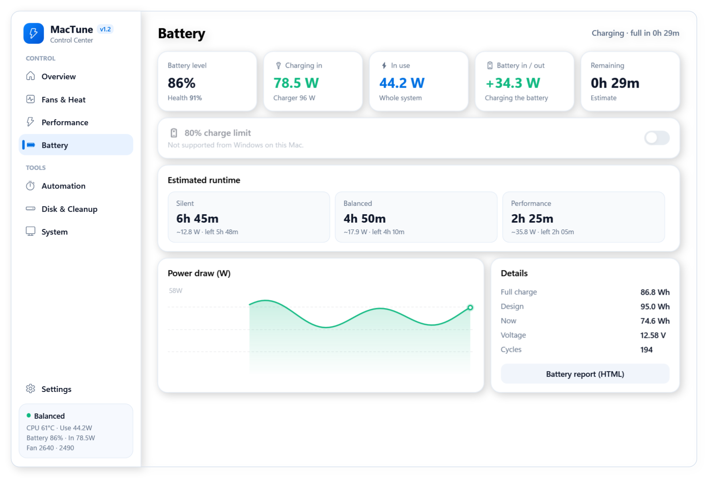
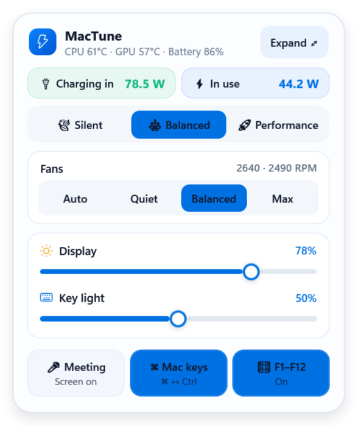
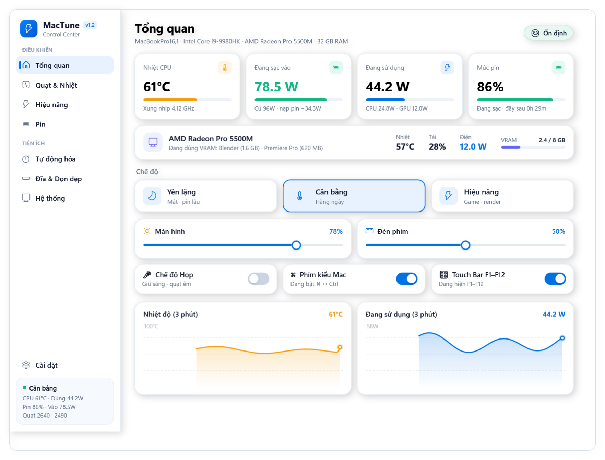
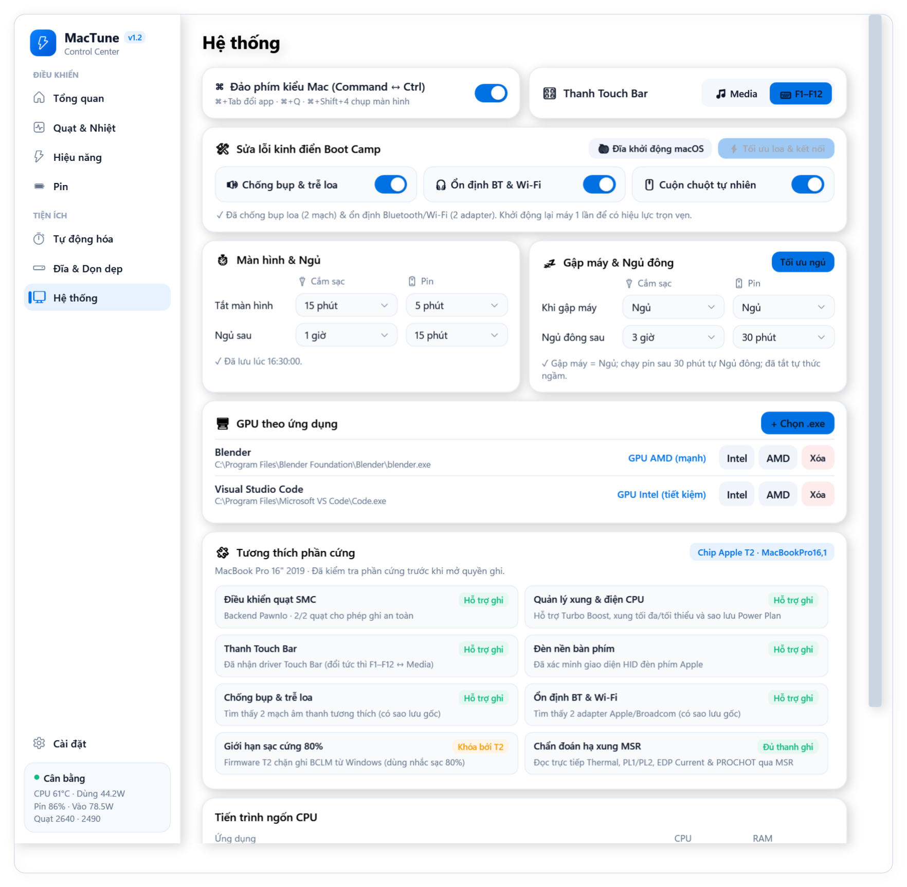

<div align="center">

# MacTune

**The honest Boot Camp control center for Intel Macs running Windows.**

Fans, CPU power, battery telemetry, keyboard backlight, Mac-style shortcuts, and reversible fixes for the everyday Windows 11 Boot Camp headaches — in one small app.

[-0078D4?style=flat-square)](#requirements)
[](#status)
[](#install)
[-10B981?style=flat-square)](#safety)
[](LICENSE)

[**🇻🇳 Tiếng Việt bên dưới**](#tiếng-việt) · [Why MacTune?](#why-mactune) · [Screenshots](#screenshots) · [What it does](#what-it-does) · [Install](#install) · [Fan setup](docs/FAN-SETUP.md) · [Safety](#safety) · [Build](#build-from-source)

</div>

---



> [!IMPORTANT]
> **Status:** personal project, developed and tested on one machine: **MacBook Pro 16" 2019 (`MacBookPro16,1`, Apple T2, Core i9-9980HK, Radeon Pro 5500M) on Windows 11**.  
> Other Intel Macs may work partly or not at all. It changes power settings and can drive your fans — read [Safety](#safety) first.

---

## Why MacTune?

Apple stopped updating Boot Camp drivers at Windows 10. Running Windows 11 on an Intel MacBook Pro works well on paper, until you live with the daily friction:

- **Thermals & noise** — Turbo Boost spikes push an i9 to 95 °C in seconds while fans react late, or surge up and down on brief 1-second loads.
- **100% disk after boot** — `SysMain` preloading 4–5 GB, aggressive `Windows Search` indexing over dev folders, and logon updaters choke Apple's SSD right after sign-in.
- **Popping speakers & clipped alerts** — Apple's Boot Camp audio driver puts the T2 speaker amp into `D3` sleep after **3 seconds** of silence, causing a faint pop or cutting off the first half-second of notification sounds.
- **Bluetooth lag & Wi-Fi ping spikes** — Windows powers down the Apple Bluetooth radio on idle and enables Broadcom packet coalescing.
- **Broken Mac muscle memory** — `⌘+C` / `⌘+V` are on the wrong key, `⌘+Tab` switches browser tabs instead of apps, there is **no `PrintScreen` key** for screenshots, and external USB/Bluetooth mice scroll backwards with no toggle in Windows Settings.
- **Hot-backpack sleep drain** — Windows wake timers wake a closed MacBook overnight, and changing power profiles resets sleep/hibernate timers.

Generic Windows "optimizer" suites sell subscriptions, fake urgency, and background telemetry while knowing nothing about Apple SMC, T2, Touch Bar, or Boot Camp drivers.

**MacTune follows three strict rules:**
1. **Honest hardware scope** — shows real sensor/power telemetry and tells you upfront [what Windows on a T2 Mac cannot do](#what-it-cannot-do).
2. **Safe & reversible** — every Boot Camp tweak backs up original Registry/driver values so a single click restores stock behavior; power profiles live in their own plans without touching Windows defaults.
3. **Zero bloat, zero network** — self-contained single-folder app, ~0.3% idle CPU, no background services when closed, no analytics, no internet access.

---

## Screenshots

### Fans, MSR Throttling Diagnostics & Fan Safety Self-Test
Dual-fan RPM gauges, thermal-smoothed curves (**Auto / Quiet / Balanced / Max cooling / Fixed**) driven by `max(CPU, AMD dGPU)`, all Apple SMC sensors, **multi-domain CPU throttling diagnostics** (**Thermal**, **Power Limit PL1/PL2**, **Current Limit EDP/IccMax**, and **Firmware / BD PROCHOT** when MSR/SMC telemetry permits), plus an independent **Fan Safety Watchdog & 4-scenario Self-Test** (app hang, lost driver, sleep, resume).



### CPU Tuning, Power Plan Backup & CSV Performance Logger
Isolated **Silent / Balanced / Performance** presets, per-source Turbo Boost / min-max state / EPP / core parking, **automatic pre-change Power Plan baseline backup & 1-click restore**, and a built-in **CPU Performance CSV Logger** (temperature, clock, package power, load, GPU, fan RPM, throttle flags) for side-by-side benchmarking.



### System, Hardware Compatibility & Reversible Boot Camp Fixes
Pre-write **Hardware Compatibility Matrix** (verifies exact Mac model & T2/Pre-T2/HID/SMC capabilities before unlocking hardware writes), **Mac-style keys** (`⌘+C/V/Z`, `⌘+Tab` app switcher, `⌃+Tab` tab switcher, `⌘+Q` close window, `⌘+Shift+4` region screenshot, suppressed bare-`Ctrl` Start Menu popups), **Touch Bar** default row (`Media` vs `F1–F12`), **speaker anti-pop**, **Bluetooth/Wi-Fi stability**, **natural external mouse scrolling**, synced sleep/lid/hibernate timers, and per-app GPU selection.



### Startup 100% Disk Optimizer & Safe Cleanup
Reversible 3-part fix for Boot Camp post-boot SSD stalls (`SysMain`, `Windows Search` dev-folder exclusions, logon updater tasks), safe >24h temp cleanup, working-set RAM trim, Apple SSD health fallback, and Task-Manager-compatible startup app toggles.



### Battery Power Flow & Tray Quick Controls
Live USB-C charger wattage in, whole-system wattage out, net battery charge/discharge rate, learned runtime estimates per profile, plus a **macOS-style tray Control Center flyout** one click away.

<p align="center">
  
  
</p>

---

## What it does

| Area | Features |
|---|---|
| **Overview** | Live CPU temperature, clock and power, USB-C charger input (W), system draw (W), battery level, discrete **AMD Radeon Pro** load / temp / power / VRAM / top apps, 3-minute charts |
| **Performance & CSV Log** | One-click **Silent / Balanced / Performance** profiles, per-source Turbo Boost / min-max CPU / EPP / core parking, **automatic baseline Power Plan backup & restore** (`.pow` + indices), and **CSV Performance Logger** (temp, clock, power, load) |
| **Fans, Safety & Diagnostics** | Dual-fan RPM, thermal-smoothed curves (`max(CPU, GPU)`), **independent Watchdog + Sleep/Resume/Driver-loss safety self-test**, all SMC sensors, and **Throttling Diagnostics** distinguishing **Thermal**, **Power Limit (PL1/PL2)**, **Current Limit (EDP)**, and **Firmware (BD PROCHOT / SMC)** |
| **Battery** | Health %, cycle count, charger input / system draw / battery net power, time remaining, learned runtime per profile, 1-click Windows HTML battery report |
| **Hardware Compatibility** | Identifies exact Intel Mac model (`T2` vs `Pre-T2` vs non-Apple PC) and probes SMC, Touch Bar, HID backlight, and Boot Camp drivers **before unlocking hardware writes** |
| **Boot Camp Fixes** | **Speaker anti-pop** (keeps T2/PortCls amp in `D0`), **Bluetooth & Broadcom Wi-Fi stability** (locks radio power-save & packet coalescing), **Natural mouse scroll** (`FlipFlopWheel`), quick **macOS Startup Disk** launcher |
| **Mac Input** | Instant **⌘ ↔ Ctrl** swap with native Mac muscle memory: `⌘+Tab` switches apps, `⌃+Tab` switches tabs, `⌘+Q` closes windows, `⌘+Shift+3/4` triggers region screenshot (`Win+Shift+S`), bare `Ctrl` tap won't pop Start Menu; **Touch Bar** `Media` ↔ `F1–F12` toggle |
| **Disk & Cleanup** | Reversible fix for **"100% disk after boot"** (`SysMain`, `Windows Search` cache exclusions, logon updaters), safe temp (>24h) & Recycle Bin cleanup, free RAM, startup apps |
| **Automation & Everyday** | Auto-switch profile on AC/battery, per-app profile + fan rules (e.g. game → Performance + Max cooling), 80% charge & low-battery alerts, tray CPU temperature icon, quick-controls flyout, **Meeting mode**, UAC-free desktop/startup launch, **English / Tiếng Việt** |

### What it cannot do

- **Hardware charge limit (80%)** — not available on T2 Macs from Windows: the T2 SMC module only allows fan keys to be written. MacTune offers a configurable "battery reached 80%" alert instead.
- **Undervolting, PL1/PL2 power limits** — locked by firmware / not safely reachable on T2 Intel Macs.
- **Full SSD S.M.A.R.T.** — Apple's T2 SSD controller hides standard NVMe SMART attributes from Windows; usage, SMC SSD temperature, and Windows storage health are shown instead.
- **Turning the AMD dGPU completely off** — Boot Camp runs with the discrete GPU wired active; you can only assign Intel vs AMD GPU per app.

---

## Requirements

- An Intel Mac with **Windows 10 or 11 (64-bit)** installed through Boot Camp, with Apple's Boot Camp drivers
- Administrator rights
- *(Optional)* For fan control, CPU package power, and clock readings on T2 Macs: [PawnIO](https://github.com/namazso/PawnIO.Setup) — see **[docs/FAN-SETUP.md](docs/FAN-SETUP.md)**

## Install

1. Download `MacTune-x.y.z-win-x64.zip` from the [**Releases**](https://github.com/PNT2110/MacTune/releases) page and extract it anywhere.
2. Right-click **`install.ps1`** → **Run with PowerShell**, and accept the administrator prompt.

That's it. MacTune is copied to `C:\Program Files\MacTune`, launched, and creates a Desktop shortcut that opens instantly **without a UAC prompt**. No .NET runtime installation is required — releases are self-contained.

If Windows blocks script execution (*"running scripts is disabled"*), open PowerShell in the extracted folder and run:

```powershell
powershell -ExecutionPolicy Bypass -File .\install.ps1
```

- **Portable use:** run `MacTune.exe` directly from the extracted folder (no installation needed).
- **Uninstall:**
  ```powershell
  powershell -ExecutionPolicy Bypass -File "C:\Program Files\MacTune\install.ps1" -Uninstall
  ```

### Optional: fan control (T2 Macs)

Fan control on T2 Macs (2018–2020) requires an unsigned PawnIO module, which means enabling Windows Test Signing. Because that is a real security and anti-cheat trade-off, it is strictly opt-in: follow **[docs/FAN-SETUP.md](docs/FAN-SETUP.md)**. Every other feature works without it.

---

## Safety

- **Fans.** Targets are clamped to each fan's hardware min/max; at **95 °C** fans immediately go to 100%; MacTune hands fans back to Apple automatic control on exit, crash (`fans-manual.flag` recovery), shutdown, lost sensor readings, or unresponsive RPMs. Still, overriding Apple's thermal controller carries inherent risk — use sensible modes.
- **Power settings.** Profiles live in three dedicated power plans (`MacTune - …`), synced for screen/sleep/lid/hibernate timers and wake-timer protection. Your built-in Windows plans are never modified.
- **Reversible tweaks.** Audio, Bluetooth, Wi-Fi, and mouse tweaks store `MacTuneBackup_*` snapshots before writing so turning a switch off restores the exact factory state. Startup apps use Windows' own Task Manager `StartupApproved` mechanism (nothing is deleted).
- **Cleanup.** Only deletes temp files older than 24 hours and, only if ticked, empties the Recycle Bin.
- **Admin rights & privacy.** Installed under `C:\Program Files\MacTune` so non-admin processes cannot tamper with the binary. **Zero telemetry, zero analytics, zero network connections.**

Provided **without any warranty** (see [LICENSE](LICENSE)). Use at your own risk.

---

## Build from source

```powershell
winget install Microsoft.DotNet.SDK.8
git clone https://github.com/PNT2110/MacTune.git
cd MacTune
dotnet build -c Release            # output: bin\Release\net8.0-windows\MacTune.exe
.\build-release.ps1 -Version 1.2.0 # self-contained zip in .\dist
```

Project layout:

```text
App.xaml, MainWindow*.xaml(.cs)   UI (WPF), split into partial classes by feature
TrayFlyoutWindow.xaml(.cs)        macOS-style tray quick-controls flyout
Controls/                         custom controls (real-time LineChart)
Services/                         hardware & Windows integration (no UI dependencies)
  SmcService, FanController       SMC (PawnIO / AppleSMC / MacHAL) & thermal-smoothed fan control
  FanSafetyWatchdog, SelfTest     independent hang watchdog, sleep/resume handoff & 4-case safety test
  CpuMsrProbe, ThrottleMonitor    MSR + sensor throttling classifier (Thermal, PL1/PL2, EDP, Firmware)
  CpuLoggerService                UTF-8 CSV performance logger with live min/avg/max session summary
  PowerService, PowerPlanBackup   powercfg wrapper, automatic pre-change .pow baseline backup & restore
  HardwareCompatibilityService    Mac model & capability verifier gating hardware writes fail-closed
  AppleKeyboardService            Touch Bar IOCTL & smart Mac shortcut hook (⌘+Tab, ⌘+Q, ⌘+Shift+4)
  BootCampFixesService            reversible audio anti-pop, BT/Wi-Fi stability & natural mouse scroll
  BootOptimizerService            100% boot disk fixes (SysMain, Search exclusions, logon updaters)
  SensorService                   LibreHardwareMonitor CPU & AMD Radeon Pro telemetry
  Loc, Loc.Dictionary             lossless runtime Vietnamese ↔ English localization
drivers/                          AppleT2Smc PawnIO module (LGPL, from RPMac) + Pawn source
docs/                             setup guides & UI screenshots
```

Diagnostic log: `C:\ProgramData\MacTune\log.txt` · Settings: `C:\ProgramData\MacTune\settings.json`.

## Contributing

Reports from other Intel Mac models (`MacBookPro15,x`, `MacBookAir8,x`, `iMac19,x`, `iMac20,x`) are very welcome — please include the model identifier, Windows build, and `C:\ProgramData\MacTune\log.txt`.  
Any hardware-writing change (SMC, HID, Registry) must **fail closed**: verify the key/device exists and back up original values before writing.

## Credits

MacTune builds on the reverse-engineering and open-source work of:
[RPMac](https://github.com/golirt1/RPMAC) (T2 SMC PawnIO module, LGPL-2.1),
[PawnIO](https://github.com/namazso/PawnIO.Setup),
[LibreHardwareMonitor](https://github.com/LibreHardwareMonitor/LibreHardwareMonitor),
[SimpleMacFan](https://github.com/ozaretskyi/SimpleMacFan),
[mac-fan-control-windows](https://github.com/charlie754/mac-fan-control-windows),
[BootCampPerformanceControl](https://github.com/mksolutionsuniversal/BootCampPerformanceControl),
and the Linux `hid-apple` driver. Full notices in [THIRD-PARTY-NOTICES.md](THIRD-PARTY-NOTICES.md).

Not affiliated with Apple Inc. Mac, MacBook Pro, Boot Camp, and Touch Bar are trademarks of Apple Inc.

## License

[GPL-3.0-or-later](LICENSE). Bundled `drivers/AppleT2Smc.*` files are licensed under LGPL-2.1-or-later.

---

## Tiếng Việt

**MacTune là bảng điều khiển trung thực, gọn nhẹ cho máy Mac Intel chạy Windows qua Boot Camp**: chỉnh quạt êm, quản lý hiệu năng CPU & GPU rời AMD, theo dõi công suất sạc/xả pin, đèn bàn phím, phím tắt chuẩn phản xạ macOS và sửa dứt điểm các "bệnh kinh điển" của Windows Boot Camp — tất cả gói gọn trong một ứng dụng mã nguồn mở, không quảng cáo, không kết nối mạng.



> **Trạng thái:** dự án cá nhân, phát triển và kiểm thử trực tiếp trên **MacBook Pro 16" 2019 (`MacBookPro16,1`, chip T2, i9-9980HK, Radeon Pro 5500M) chạy Windows 11**. Các dòng Mac Intel khác có thể hoạt động tốt từng phần hoặc khác biệt cảm biến.

### Những phiền toái Boot Camp được giải quyết



- **🔊 Chống bụp & trễ tiếng loa MacBook** — giữ mạch khuếch đại `Apple Audio` ở trạng thái thức (`D0`), xóa hiện tượng kêu *tách/bụp* nhẹ hoặc bị nuốt 0,5 giây đầu âm thông báo sau 3 giây im lặng.
- **⌨️ Phím kiểu Mac đúng phản xạ macOS** — đảo `⌘ ↔ Ctrl` tức thì không cần khởi động lại, hỗ trợ luôn **`⌘ + Tab` đổi ứng dụng**, **`⌃ + Tab` đổi tab trình duyệt**, **`⌘ + Q` đóng cửa sổ**, **`⌘ + Shift + 4` chụp vùng màn hình** (bù cho bàn phím Mac thiếu nút `PrtScn`), và chặn bung nhầm Start Menu khi chạm lẻ phím `Ctrl`.
- **🎧 Ổn định Bluetooth & Wi-Fi Broadcom** — khóa Windows tự ngắt nguồn ngầm chip Bluetooth (hết khựng chuột / rớt AirPods sau khi nghỉ) và tắt gom gói `Packet Coalescing` gây giật ping Wi-Fi.
- **🖱 Cuộn tự nhiên cho chuột rời & Touch Bar 1 chạm** — đảo chiều lăn chuột USB/Bluetooth giống hệt Trackpad macOS; đổi nhanh Touch Bar giữa dãy `Media` và `F1–F12`.
- **🚀 Chống 100% Disk sau khi mở máy** — tắt nạp dồn 4–5 GB của `SysMain`, hoãn `Windows Search` & tự loại trừ thư mục code/cache (`node_modules`, `.git`, `bin`, `obj`...), hoãn các tác vụ cập nhật chạy dồn lúc đăng nhập.
- **❄️ Quạt êm, Watchdog chống treo & bảo vệ Sleep/Resume** — đường cong quạt làm mượt nhiệt độ theo cả CPU lẫn GPU rời AMD, có luồng **Watchdog độc lập** tự trả quạt về Apple nếu giao diện treo, tự nhả về Auto khi mất driver / vào Sleep, kiểm tra lại phần cứng khi Resume và kèm công cụ **Kiểm thử an toàn quạt 4 tình huống** ngay trong app.
- **🔬 Chẩn đoán hạ xung đa miền & Ghi nhật ký CSV** — phân biệt rõ **Thermal** (nhiệt nhân / VRM), **Power Limit** (`PL1`/`PL2`), **Current Limit** (`EDP`/`IccMax`) và **Firmware** (`BD PROCHOT` / khóa SMC / củ sạc yếu) khi dữ liệu thanh ghi MSR & cảm biến cho phép; tích hợp **CPU Performance Logger** xuất file `.csv` để đối chiếu trước/sau.
- **💾 Tự động sao lưu Power Plan & Kiểm tra tương thích phần cứng** — tự động sao lưu nguyên trạng Power Plan (`.pow` + chỉ số AC/DC) trước khi thay đổi để khôi phục 1 chạm; xác minh đúng dòng máy Mac (`T2`, `Pre-T2`, có/không Touch Bar, đèn phím, SMC) trước khi mở quyền ghi xuống phần cứng.

### Cài đặt (2 bước, không cần cài .NET)

1. Tải file `MacTune-x.y.z-win-x64.zip` tại trang [**Releases**](https://github.com/PNT2110/MacTune/releases) và giải nén.
2. Chuột phải **`install.ps1`** → **Run with PowerShell**, bấm **Yes** khi Windows hỏi quyền Admin.

App tự cài vào `C:\Program Files\MacTune`, mở lên ngay và tạo icon ngoài Desktop (mở không bị hỏi bảng UAC).
- **Đổi ngôn ngữ (Việt / Anh):** vào **Cài đặt → Ngôn ngữ**.
- **Chạy bản Portable:** mở thẳng `MacTune.exe` trong thư mục giải nén.
- **Gỡ cài đặt:** `powershell -ExecutionPolicy Bypass -File "C:\Program Files\MacTune\install.ps1" -Uninstall`.

### Điều khiển quạt trên máy chip T2 (tùy chọn)

Trên Mac có chip T2 (2018–2020), việc ghi tốc độ quạt cần driver PawnIO bản Unrestricted và bật Test Signing của Windows. Vì việc này **làm giảm bảo mật hệ thống** và một số game có anti-cheat (như Valorant) sẽ không chạy, tính năng này hoàn toàn tùy chọn: xem hướng dẫn chi tiết trong `HUONG-DAN-QUAT.txt` (tiếng Việt) hoặc [docs/FAN-SETUP.md](docs/FAN-SETUP.md) (tiếng Anh). Mọi tính năng khác đều chạy bình thường không cần bước này.

### Những thứ phần cứng không cho phép trên Windows

- **Giới hạn sạc cứng 80% trên máy T2** (thay bằng cảnh báo thông minh khi pin sạc chạm 80%)
- **Undervolt CPU, mở khóa PL1/PL2** (bị khóa bởi firmware)
- **Đọc toàn bộ S.M.A.R.T. chuẩn của SSD hàn chết Apple** (hiển thị dung lượng, nhiệt độ SMC và trạng thái sức khỏe từ Windows)
- **Tắt hoàn toàn nguồn card rời AMD** (Boot Camp nối cứng card rời; chỉ chọn được GPU Intel/AMD cho từng ứng dụng)

### An toàn & Quyền riêng tư

Quạt luôn được kẹp trong ngưỡng RPM tối thiểu/tối đa của từng quạt, tự chạy tối đa khi chạm 95 °C, và tự trả quyền điều khiển về cho Apple khi thoát app, app gặp sự cố hoặc tắt máy. Mọi tinh chỉnh Registry đều lưu bản sao lưu để bật/tắt hoàn tác 100%. Ứng dụng **không thu thập dữ liệu, không quảng cáo, không kết nối Internet** và được cung cấp miễn phí theo giấy phép [GPL-3.0](LICENSE) (**không kèm bảo hành**, bạn tự chịu rủi ro khi sử dụng).
